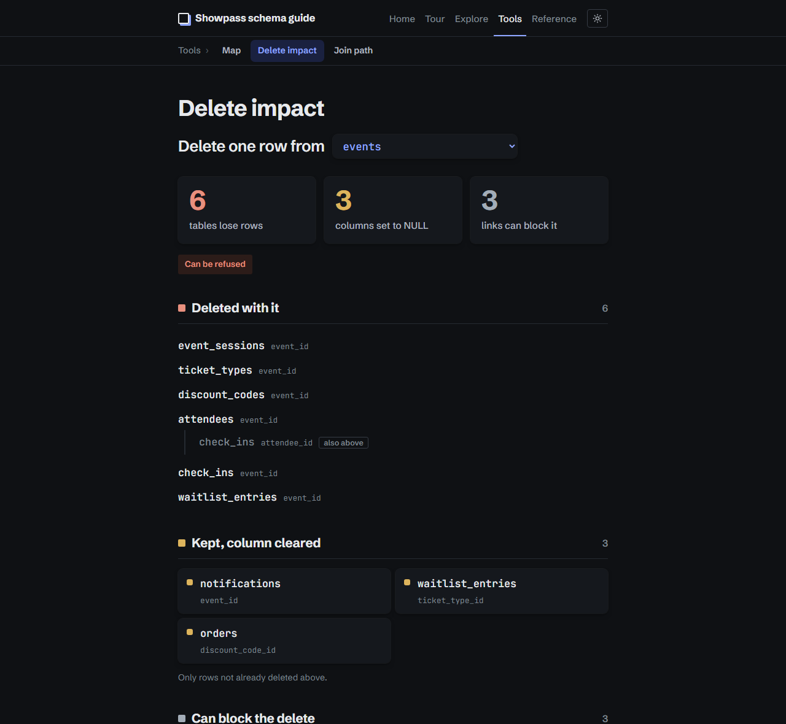
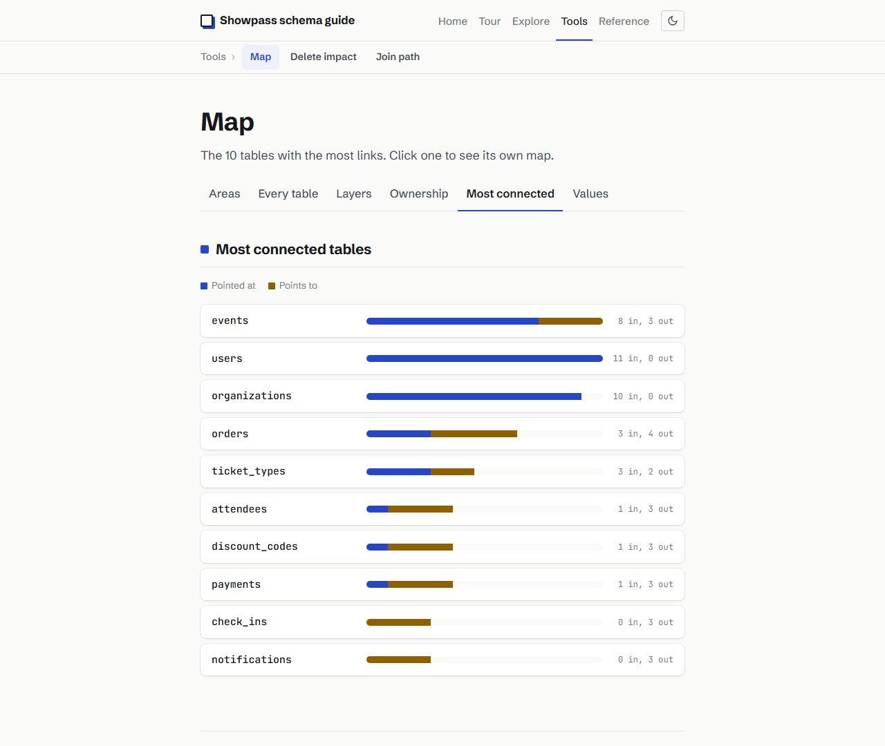
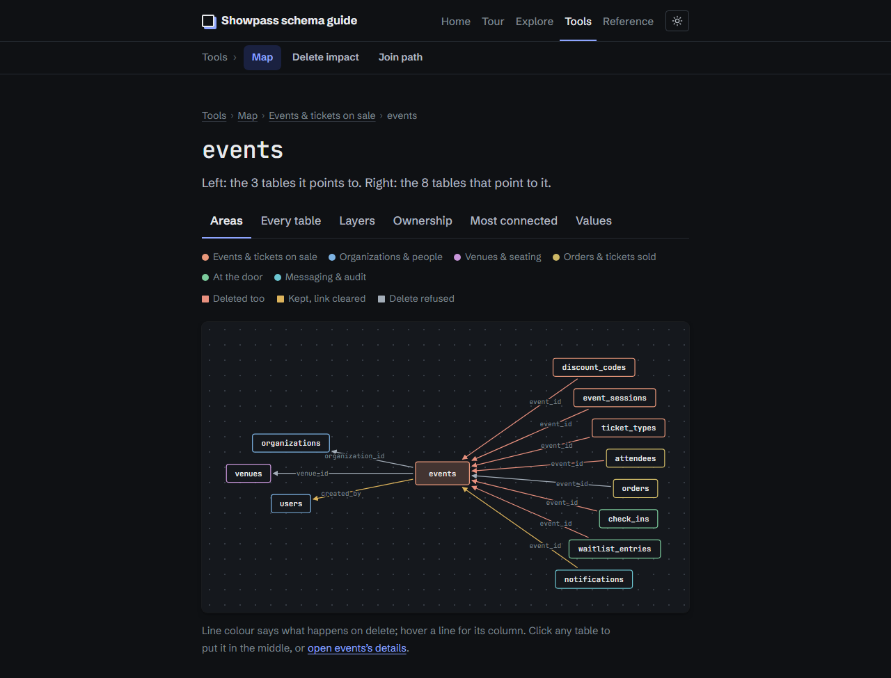
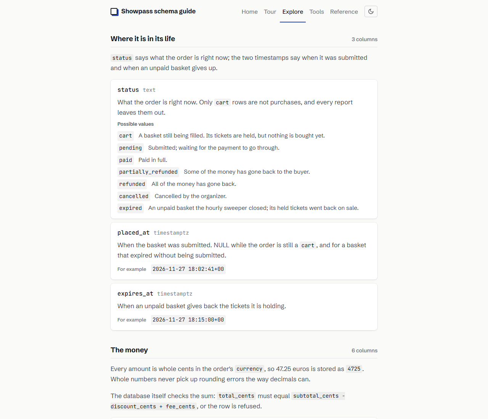

# schema-guide for Claude Code

**Understand a project's database without digging through every table, migration, and foreign key.**

schema-guide is an open-source Claude Code plugin that turns your database schema into an interactive, offline HTML guide. It explains what the tables do, how they connect, what happens when records are deleted, and how to JOIN tables together.

One HTML file. No server needed to view it. Easy to share with a teammate.


## Quick start

### Install

In Claude Code:

```text
/plugin install schema-guide --marketplace A-Piyas-04/schema-guide
```

If you're using Claude Code before version `2.1.275`, add the marketplace first:

```text
/plugin marketplace add A-Piyas-04/schema-guide
/plugin install schema-guide@schema-guide-plugins
```

### Generate your guide

Open your project in Claude Code and run:

```text
/schema-guide:build
```

The plugin reads the available schema and project code, then generates:

```text
docs/schema-guide.html
```

Open that file in a browser to explore your database.

After changing your schema, run:

```text
/schema-guide:update
```

This checks what changed and updates the relevant parts of your guide without unnecessarily rewriting your existing explanations.

If Claude can't locate the database, you can provide a connection URL or SQLite file:

```text
/schema-guide:build postgres://localhost/app_dev
```

Both plugin commands run only when you invoke them.

## What you get

### 1. Interactive schema map

Explore tables and their relationships on a pan-and-zoom canvas. See how the database fits together instead of jumping between schema files.


### 2. A guided database tour

Walk through the database one concept at a time. Useful when joining an unfamiliar project or onboarding a teammate.


### 3. Delete impact analysis

See which relationships may cascade, set values to `NULL`, or prevent a deletion. The guide distinguishes database-enforced foreign keys from inferred references so it does not present them as equally safe.



### 4. JOIN path finder

Find a path between tables and copy the generated SQL. For projects that use them, Kysely and Knex output are also available.


### 5. Most connected tables

Identify the tables with the most incoming and outgoing relationships, then focus on one table to see its immediate dependencies.





### 6. Table details and reference pages

Explore columns, keys, indexes, constraints, relationship details, and plain-language descriptions. The guide also includes different schema views, keyboard navigation, responsive layouts, and a dark-mode toggle.

**Try the included demo:** [`examples/demo/`](examples/demo/). Its generated guide is based on a synthetic 21-table database. The screenshots above come from that demo.

## Supported databases and schema sources

When a running database is available, schema-guide can inspect:

- PostgreSQL
- MySQL and MariaDB
- SQLite

When the database is not running, it can work from project-declared schemas, such as SQL migrations and supported ORM models (including Prisma, Drizzle, TypeORM, Sequelize, SQLAlchemy, Django, Laravel, and JPA). In this case, the output is explicitly marked as **derived from schema files, not verified against a running database**.

If a project has no database schema, the plugin does not pretend there is one. It stops and asks whether you want to generate a **proposed schema** based on the codebase. Any resulting proposal is clearly labeled as a proposal, not existing database documentation.

## How it works

schema-guide keeps database facts separate from AI-written explanations.

1. **Read:** A zero-dependency CLI collects table definitions, columns, keys, foreign keys, delete rules, indexes, and other available schema facts. With live database inspection, these facts come from your database.
2. **Explain:** Claude examines the project code and writes descriptions of tables, fields, functional areas, and the guided tour.
3. **Build and check:** The CLI combines facts and descriptions into a self-contained HTML page and validates that referenced schema names exist.
4. **Update:** A later run detects changes and revises the affected explanations while preserving unrelated edits.

The generated files are:

```text
docs/schema-guide.html        # Interactive HTML guide
.schema-guide/facts.json     # Schema facts
.schema-guide/guide.json     # Editable explanations
```

Commit all three if you want to share the guide and keep its editable source with your project.

### What is verified and what is not?

The plugin checks schema structure against the available source. Claude's descriptions of business meaning are interpretations of your code, not guaranteed facts. Review those descriptions before treating them as a specification.

Relationships that are referenced in code but not enforced by the database are marked separately. For example, a bare `user_id` field is not automatically treated as a verified foreign key.

Your corrections can be made in `.schema-guide/guide.json`, and the update workflow is designed to retain them when unrelated parts of the schema change.

## Install through the VS Code extension

1. Open the **Claude Code** panel and type `/plugins`.
2. In **Marketplaces**, add `A-Piyas-04/schema-guide`.
3. In **Plugins**, find **schema-guide** and select **Install**.
4. Choose **Install for you**, **Install for this project**, or **Install locally**, depending on who needs the plugin.
5. Restart the Claude session if the plugin manager asks you to.
6. Type `/` and look for `/schema-guide:build` and `/schema-guide:update`.

A project-scoped setting can make the plugin available for collaborators, but each collaborator still needs to install it in their own clone:

```sh
claude plugin install schema-guide@schema-guide-plugins --scope project
```

<<<<<<< HEAD
## Use

```
/schema-guide:build      # first time: reads the schema, writes the guide, builds docs/schema-guide.html
/schema-guide:update     # after a migration: shows what changed and updates only that
```

Pass a database URL or SQLite file if Claude can't find one: `/schema-guide:build postgres://localhost/app_dev`.

Both commands are user-invoked only, so nothing about this plugin enters Claude's context until you run one.

## What it looks like

Every screenshot below is a page of [`examples/demo/schema-guide.html`](examples/demo/), built by the plugin from the synthetic 21-table schema in this repo. Clone and open it to click through the real thing.

### Tour — the database explained in order, one idea per step


### Delete impact — what one `DELETE` really takes with it


### Join path — the shortest join between any two tables


Also available as Kysely or Knex when your project uses them.

### Most connected — where the schema actually hangs together


Click any table in that list to drop it into the middle of its own map — what it points to on the left, what points to it on the right, every line labelled with the column and coloured by what happens on delete:


### Examples — what each column actually holds

A table with eighteen columns tells a newcomer very little by name alone. What can `status` be? What is a `mime_type`, or `fee_bps`? Every table's **Examples** tab answers that in plain words: its columns in a few groups, what each one means (jargon explained), the values it really holds, made-up rows showing the table in different situations, and short "what happens when…" stories that show a row changing.



A column with a value list shows every allowed value, read from the database. The sample rows are labelled as made up, and `check` refuses any that the schema couldn't hold: a value outside a column's list, or `NULL` in a `NOT NULL` column.

Plus **Explore** (every area and table, with columns, examples, links, indexes and rules in plain words), **Reference** (every link, index and rule, one topic per page), and five more map views: areas, dependency layers, ownership trees, and every value list. Opens in light mode, with a dark toggle that each reader's browser remembers. Keyboard-navigable, and sized for a phone as well as a desktop.

Three files land in your project: `docs/schema-guide.html` (the page), `.schema-guide/facts.json` (the schema) and `.schema-guide/guide.json` (the words — yours to edit). Commit all three.

**One thing to be clear about.** The structure is read, not guessed: tables, columns, keys, delete rules and indexes come from introspecting your database, and `check` fails the build if the prose names anything that isn't there. The *explanations* around that structure — what a table is for, what a column means, which tables belong together — are Claude's reading of your code, and Claude can misread code. Treat the guide as a well-informed colleague's write-up rather than a specification: worth trusting to learn from, worth verifying before you depend on it. Every page says so in its footer, and corrections go in `guide.json`, where the next `update` will leave them alone. The sample rows on the Examples tabs are invented to show the shape of the data, and the page says so: none of them are read from your database.

## How it works

The schema and the prose are kept apart, which is what makes updates safe:

- A zero-dependency CLI reads the real database — PostgreSQL, MySQL/MariaDB or SQLite — into `facts.json`. Tables, columns, keys, foreign keys with their delete rules, indexes, CHECKs and value lists. Nothing leaves your machine.
- Claude reads your code and writes `guide.json`: the areas, the one-line purpose of every table, the column notes that aren't obvious, the tour, and each table's Examples tab.
- The CLI renders both into the page, then checks the result: every name in the prose must exist in the schema, every page must render, and no two boxes on a map may overlap.

On `update`, the CLI diffs the new schema against the last one and prints exactly what changed. Claude rewords only those parts, so your wording stays put.

Links the database doesn't enforce — bare `*_id` columns, anything crossing a service boundary — are recorded with `"enforced": false` and drawn dashed, so delete impact tells the truth instead of calling every delete safe. See [the schema format](plugins/schema-guide/reference/facts-format.md).

## What it does with your project

`build` works out which of three situations it is in, and the page never claims more than the situation allows.

### 1. There's a database it can reach

The normal case. The CLI introspects PostgreSQL, MySQL/MariaDB or SQLite directly — tables, columns, keys, foreign keys with their delete rules, indexes, CHECKs and value lists. Everything on the page is a fact read from the server.

### 2. There's a schema, but no running database

CI, a fresh clone, no credentials, or a schema that only exists as migrations. Claude writes the schema from what the project declares — SQL migrations, `schema.prisma`, Drizzle/TypeORM/Sequelize/SQLAlchemy/Django/Laravel models, JPA `@Entity` classes — and the page says so on Home and in the footer: **written from schema files, not verified against a running database.**

### 3. There's no schema at all

An app that persists to AsyncStorage, Redis, `localStorage`, documents or bundled JSON — or stores nothing yet. There is no database to document, so **`build` stops and asks** rather than quietly inventing one:

> This project has no database. I found no SQL schema, no migrations and no ORM model definitions — ten AsyncStorage keys in `src/services/storage.ts` and three bundled JSON files.
>
> I can propose a schema instead: I'd read the app's types, storage layer, services and screens, and design the tables the project would need. Every page would be labelled a proposal, because none of it would exist yet. Want that, or shall I stop here?

Say yes and you get a real piece of design work — Claude reads the storage layer, the types, the data actually in the fixtures, and the services and screens that query it, then proposes tables with primary keys, foreign keys whose delete rules match how the app behaves, indexes for the lookups it actually found, and value lists taken from the unions in the code.

What you **cannot** do is mistake it for documentation. The title reads `(no database)`, the headline is "A proposed database for …", Home carries this, and every other page carries a strip saying the same thing:


This is the scenario that nearly shipped broken; [the evaluation](docs/evaluation.md) explains what went wrong.

=======
>>>>>>> 6f26eb70b31e878e2faf8d716e0de3d4dbd3679d
## Requirements

- Node.js 18+ (`22.5+` for SQLite without the `sqlite3` CLI)
- `psql` for PostgreSQL or `mysql` for MySQL/MariaDB when introspecting those databases
- Chrome or Edge only for the optional browser validation check

The generated guide itself does not need a server or a build system to view.

## Tested on real codebases

Before the 1.0 release, schema-guide was tested end-to-end on three different projects:

| Project | Schema | What testing showed |
| --- | --- | --- |
| FastAPI + SQLModel with SQLite | 24 tables, 44 foreign keys | Live schema read; 197 pages and 34 maps checked |
| Spring Boot with seven PostgreSQL-backed services | 14 tables with no enforced foreign keys | Exposed misleading relationship and delete-impact claims |
| React Native using AsyncStorage and JSON | No relational database | Exposed a case where a proposed schema was wrongly presented as an existing one |

The latter two cases led to important fixes. The plugin now distinguishes unenforced references, handles cross-database relationships more carefully, and clearly separates existing schemas from proposed ones. Thirteen smaller defects were also fixed during evaluation.

For the test results, the original defects, fixes, and remaining limitations, see [the evaluation report](docs/evaluation.md).

## Repository structure

| Path | Purpose |
| --- | --- |
| [`plugins/schema-guide/`](plugins/schema-guide/) | Installable plugin |
| [`plugins/schema-guide/skills/`](plugins/schema-guide/skills/) | Build and update commands |
| [`plugins/schema-guide/scripts/`](plugins/schema-guide/scripts/) | Read, build, and check CLI |
| [`plugins/schema-guide/template/`](plugins/schema-guide/template/) | Self-contained HTML template |
| [`plugins/schema-guide/reference/`](plugins/schema-guide/reference/) | Data format reference |
| [`examples/demo/`](examples/demo/) | Sample 21-table database and guide |
| [`docs/evaluation.md`](docs/evaluation.md) | Real-codebase evaluation |
| [`test/run.mjs`](test/run.mjs) | End-to-end tests |

## Development

Run the automated tests and validate the plugin:

```sh
node test/run.mjs
node test/run.mjs --browser
claude plugin validate plugins/schema-guide --strict
claude plugin validate . --strict
```

To test the plugin directly from a local clone:

```sh
claude --plugin-dir /path/to/schema-guide/plugins/schema-guide
```

See [CONTRIBUTING.md](CONTRIBUTING.md) for contribution details.

## Feedback and contributions

Found an issue or have an idea? [Open an issue](https://github.com/A-Piyas-04/schema-guide/issues) or submit a pull request.

**License:** [MIT](LICENSE)
