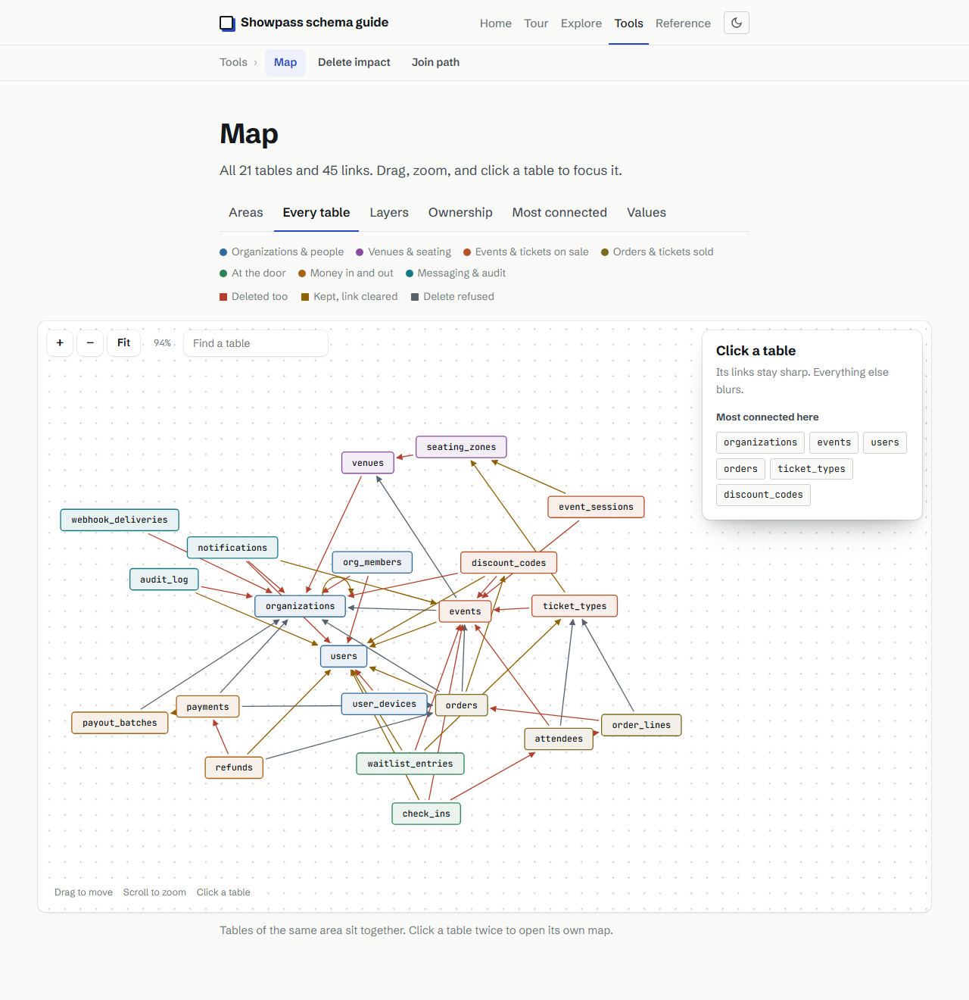
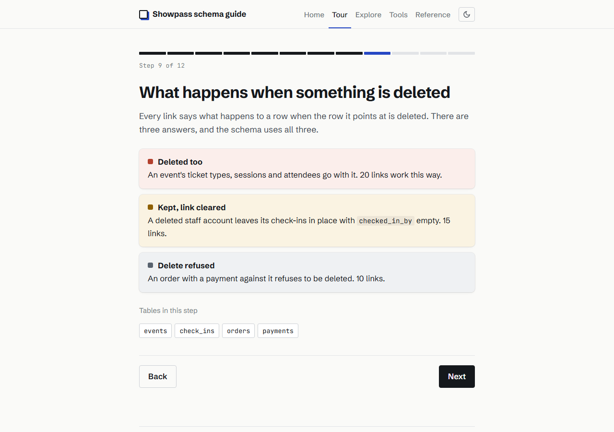
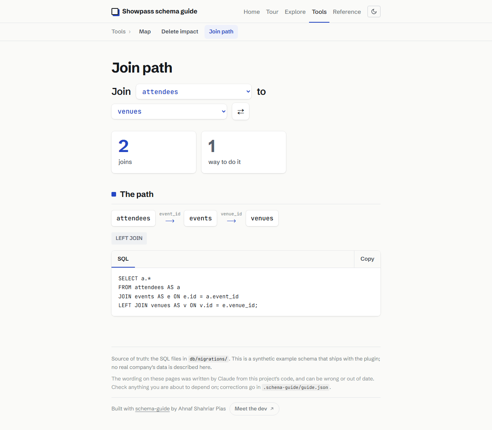
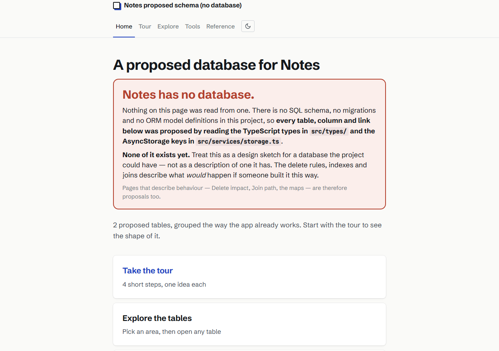

# schema-guide for Claude Code

Turn any project's database schema into a step-by-step, offline HTML guide — a tour, every table and link in plain words, a pan-and-zoom map, delete impact and join paths. Two commands: **build** and **update**.

One self-contained HTML file. No dependencies, no server, no build step. Give a new teammate the link instead of a walkthrough.



## Install

```
/plugin install schema-guide --marketplace A-Piyas-04/schema-guide
```

On Claude Code before 2.1.275, add the marketplace first:

```
/plugin marketplace add A-Piyas-04/schema-guide
/plugin install schema-guide@schema-guide-plugins
```

## Use

```
/schema-guide:build      # first time: reads the schema, writes the guide, builds docs/schema-guide.html
/schema-guide:update     # after a migration: shows what changed and updates only that
```

Pass a database URL or SQLite file if Claude can't find one: `/schema-guide:build postgres://localhost/app_dev`.

Both commands are user-invoked only, so nothing about this plugin enters Claude's context until you run one.

## What it looks like

Every screenshot below is a page of [`examples/demo/schema-guide.html`](examples/demo/), built by the plugin from the synthetic 21-table schema in this repo. Clone and open it to click through the real thing.

### Tour — the database explained in order, one idea per step



### Delete impact — what one `DELETE` really takes with it


### Join path — the shortest join between any two tables



Also available as Kysely or Knex when your project uses them.

### Most connected — where the schema actually hangs together


Click any table in that list to drop it into the middle of its own map — what it points to on the left, what points to it on the right, every line labelled with the column and coloured by what happens on delete:


Plus **Explore** (every area and table, with columns, links, indexes and rules in plain words), **Reference** (every link, index and rule, one topic per page), and five more map views: areas, dependency layers, ownership trees, and every value list. Opens in light mode, with a dark toggle that each reader's browser remembers. Keyboard-navigable, and sized for a phone as well as a desktop.

Three files land in your project: `docs/schema-guide.html` (the page), `.schema-guide/facts.json` (the schema) and `.schema-guide/guide.json` (the words — yours to edit). Commit all three.

**One thing to be clear about.** The structure is read, not guessed: tables, columns, keys, delete rules and indexes come from introspecting your database, and `check` fails the build if the prose names anything that isn't there. The *explanations* around that structure — what a table is for, what a column means, which tables belong together — are Claude's reading of your code, and Claude can misread code. Treat the guide as a well-informed colleague's write-up rather than a specification: worth trusting to learn from, worth verifying before you depend on it. Every page says so in its footer, and corrections go in `guide.json`, where the next `update` will leave them alone.

## How it works

The schema and the prose are kept apart, which is what makes updates safe:

- A zero-dependency CLI reads the real database — PostgreSQL, MySQL/MariaDB or SQLite — into `facts.json`. Tables, columns, keys, foreign keys with their delete rules, indexes, CHECKs and value lists. Nothing leaves your machine.
- Claude reads your code and writes `guide.json`: the areas, the one-line purpose of every table, the column notes that aren't obvious, the tour.
- The CLI renders both into the page, then checks the result: every name in the prose must exist in the schema, every page must render, and no two boxes on a map may overlap.

On `update`, the CLI diffs the new schema against the last one and prints exactly what changed. Claude rewords only those parts, so your wording stays put.

Links the database doesn't enforce — bare `*_id` columns, anything crossing a service boundary — are recorded with `"enforced": false` and drawn dashed, so delete impact tells the truth instead of calling every delete safe. See [the schema format](plugins/schema-guide/reference/facts-format.md).

## What it does with your project

`build` works out which of three situations it is in, and the page never claims more than the situation allows.

### 1. There's a database it can reach

The normal case. The CLI introspects PostgreSQL, MySQL/MariaDB or SQLite directly — tables, columns, keys, foreign keys with their delete rules, indexes, CHECKs and value lists. Everything on the page is a fact read from the server.

### 2. There's a schema, but no running database

CI, a fresh clone, no credentials, or a schema that only exists as migrations. Claude writes the schema from what the project declares — SQL migrations, `schema.prisma`, Drizzle/TypeORM/Sequelize/SQLAlchemy/Django/Laravel models, JPA `@Entity` classes — and the page says so on Home and in the footer: **written from schema files, not verified against a running database.**

### 3. There's no schema at all

An app that persists to AsyncStorage, Redis, `localStorage`, documents or bundled JSON — or stores nothing yet. There is no database to document, so **`build` stops and asks** rather than quietly inventing one:

> This project has no database. I found no SQL schema, no migrations and no ORM model definitions — ten AsyncStorage keys in `src/services/storage.ts` and three bundled JSON files.
>
> I can propose a schema instead: I'd read the app's types, storage layer, services and screens, and design the tables the project would need. Every page would be labelled a proposal, because none of it would exist yet. Want that, or shall I stop here?

Say yes and you get a real piece of design work — Claude reads the storage layer, the types, the data actually in the fixtures, and the services and screens that query it, then proposes tables with primary keys, foreign keys whose delete rules match how the app behaves, indexes for the lookups it actually found, and value lists taken from the unions in the code.

What you **cannot** do is mistake it for documentation. The title reads `(no database)`, the headline is "A proposed database for …", Home carries this, and every other page carries a strip saying the same thing:



This is the scenario that nearly shipped broken; [the evaluation](docs/evaluation.md) explains what went wrong.

## Requirements

- Node.js 18+ (22.5+ for SQLite without the `sqlite3` CLI).
- `psql` or `mysql` for those databases. Not needed for SQLite or for reading from files.
- Chrome or Edge, optionally, for the in-browser check.
- A relational schema for scenarios 1 and 2. Scenario 3 needs only a codebase.

## Evaluation

Before 1.0, the plugin was run end to end on three real codebases of deliberately different shapes. Two of the three found defects serious enough to block release — both of the same kind: **the pipeline reported success on output that wasn't true.**

| | Stack | Schema | Result |
| --- | --- | --- | --- |
| **A** | FastAPI + SQLModel, SQLite | 24 tables, 44 foreign keys | Read live. 197 pages, 34 maps, browser check passed. One cosmetic defect |
| **B** | Spring Boot, 7 services, 7 PostgreSQL databases | 14 tables, **0** foreign key constraints | Built, passed — and was half wrong |
| **C** | React Native, AsyncStorage + JSON files | none | Invented a 9-table schema and called it documentation |

**Case B** stores every relationship as a bare `Long` with no `FOREIGN KEY`. An honest schema therefore had no links at all, and the page told every reader that deleting a row was free — *"Nothing. The delete always succeeds."* — when deleting a rider orphans rows in six other databases. Recording those references as ordinary foreign keys instead produced a page that looked excellent and was false, offering a copy button for a `JOIN` across two databases that no server can run. `check` passed both.

**Case C** has no database at all. The build skill had no stopping rule, so it built a 9-table schema with cascade rules and indexes out of TypeScript interfaces, presented it as documentation, and `check --browser` stamped it "passed" across 88 pages.

Both are fixed. `"enforced": false` and `"database"` let a schema say what is true about links the database doesn't police; the three scenarios above keep a proposal from ever reading as a record; and `check` now errors or warns on each of the shapes that used to pass silently. Thirteen smaller defects were fixed alongside them.

[**`docs/evaluation.md`**](docs/evaluation.md) has the full record: what each run produced, the exact output, every defect with its fix, and the limits that remain.

## In this repository

| Path | What |
| --- | --- |
| `plugins/schema-guide/` | The plugin — all that gets installed |
| `plugins/schema-guide/skills/` | The two commands |
| `plugins/schema-guide/scripts/` | The CLI: `read`, `build`, `check` |
| `plugins/schema-guide/template/` | The page: one HTML file, CSS and engine inline |
| `plugins/schema-guide/reference/` | The `facts.json` and `guide.json` formats |
| `examples/demo/` | A synthetic 21-table schema and its finished guide |
| `test/run.mjs` | End-to-end tests |
| `docs/evaluation.md` | How it did on three real codebases |

## Develop

```sh
node test/run.mjs                                   # the example and every fixture
node test/run.mjs --browser                         # adds the Chrome/Edge probe
claude plugin validate plugins/schema-guide --strict
claude plugin validate . --strict
```

To try a local copy without publishing, start Claude Code with the plugin directory:

```sh
claude --plugin-dir /path/to/schema-guide/plugins/schema-guide
```

Changes to the plugin show up the next time you start a session — nothing to reinstall. See [CONTRIBUTING.md](CONTRIBUTING.md).

Issues and pull requests welcome. MIT licensed.
